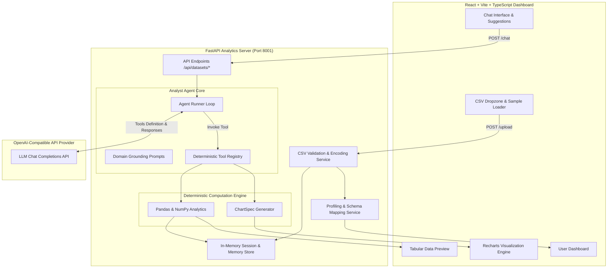

# AI-Powered E-Commerce Data Analyst Agent

[](https://www.python.org/)
[](https://fastapi.tiangolo.com/)
[](https://react.dev/)
[](https://www.typescriptlang.org/)
[](https://tailwindcss.com/)
[](https://recharts.org/)
[](https://docs.pytest.org/)

An enterprise-grade, conversational business intelligence agent built to analyze e-commerce sales datasets. Users can upload any sales CSV file without relying on rigid column schemas, ask complex natural-language business questions, and receive grounded calculations, executive takeaways, and interactive visualizations (bar charts, line charts, pie charts, scatter plots).

---

## 🌟 Core Features

- **Dynamic Schema Discovery & Profiling**: Automatically infers column data types, calculates statistical distributions, detects missing values/anomalies, and maps business roles (`revenue`, `unit_price`, `quantity`, `order_date`, `order_id`, `category`, `product`, `region`, `discount`, `profit`) without hardcoded schemas.
- **Deterministic Analytics Engine**: All quantitative calculations (totals, averages, top rankings, cohort comparisons, month-over-month growth, and IQR outlier detection) are executed by audited Python/Pandas routines. **The LLM never hallucinates or guesses numbers.**
- **OpenAI-Compatible Tool Loop**: Real function-calling execution loop with bounded iterations (max 5 by default). Supports custom API base URLs and any OpenAI-compatible provider.
- **Offline / Deterministic Fallback Mode**: If LLM credentials are not yet configured, the system executes deterministic analytics and chart generation without failing.
- **Interactive Recharts Visualizations**: Backend passes structured, aggregated chart specifications directly to the React frontend.
- **Conversational Memory & Pronoun Resolution**: Supports natural follow-up questions within the active session (e.g., *"Which category had the highest sales?"* followed by *"What about its monthly trend?"*).
- **Session Isolation & Privacy**: Datasets are isolated per session in memory; data is never persisted or transmitted to third parties without your explicit LLM configuration.

---

## 🏗️ Architecture



---

## 📂 Project Structure

```text
DataAnalyst_Agent/
├── backend/
│   ├── app/
│   │   ├── __init__.py
│   │   ├── main.py                     # FastAPI application entrypoint & middleware
│   │   ├── config.py                   # Pydantic Settings with .env loading
│   │   ├── api/
│   │   │   ├── __init__.py
│   │   │   └── routes.py               # Dataset upload, profile, preview, chat, mappings
│   │   ├── services/
│   │   │   ├── __init__.py
│   │   │   ├── csv_service.py          # CSV parsing, encoding fallback, size checks
│   │   │   ├── profiling_service.py    # Statistical profiling & semantic heuristic detection
│   │   │   ├── schema_mapping_service.py # Role-to-column resolution
│   │   │   ├── analysis_service.py     # Deterministic Pandas analytics (sum, group, trend, IQR)
│   │   │   ├── chart_service.py        # Recharts ChartSpec JSON generation
│   │   │   ├── llm_service.py          # OpenAI SDK client configured with custom base_url
│   │   │   └── session_service.py      # Session isolation & conversation memory
│   │   ├── agent/
│   │   │   ├── __init__.py
│   │   │   ├── agent.py                # Bounded tool-calling loop & offline routing
│   │   │   ├── tools.py                # OpenAI function calling specs & tool executor
│   │   │   └── prompts.py              # Domain analyst system prompt & memory injection
│   │   └── schemas/
│   │       ├── __init__.py
│   │       ├── dataset.py              # Profile, column, mapping Pydantic schemas
│   │       ├── agent.py                # Chat request, response, table, tool trace schemas
│   │       ├── charts.py               # ChartSpec & Series schemas
│   │       └── errors.py               # Standardized error payload
│   ├── data/
│   │   ├── sample_ecommerce.csv        # Synthetic e-commerce dataset for testing & demo
│   │   └── .gitkeep
│   ├── tests/
│   │   ├── __init__.py
│   │   ├── conftest.py                 # Pytest fixtures & mock clients
│   │   ├── test_csv.py                 # Upload, validation, size limits, and encodings
│   │   ├── test_profiling.py           # Profiling, role detection, schema resolution
│   │   ├── test_tools.py               # Deterministic calculations, aggregations, charts
│   │   └── test_agent.py               # Mocked LLM loop, session isolation, iteration limits
│   ├── .env.example
│   ├── .env
│   ├── .gitignore
│   └── requirements.txt
├── frontend/
│   ├── src/
│   │   ├── components/
│   │   │   ├── Navbar.tsx              # Top bar, status badge, dataset pill
│   │   │   ├── FileUpload.tsx          # Drag & drop upload & 1-click sample dataset loader
│   │   │   ├── DatasetSidebar.tsx      # Column inspector, detected roles, quick queries
│   │   │   ├── ChatInterface.tsx       # Message list, tool audit tags, markdown, follow-ups
│   │   │   ├── InteractiveChart.tsx    # Recharts bar, line, pie, and scatter renderer
│   │   │   ├── DataTablePreview.tsx    # Clean tabular view for analytical outputs
│   │   │   ├── SchemaMappingModal.tsx  # Interactive semantic column mapping editor
│   │   │   └── DataPreviewModal.tsx    # Raw dataset preview table
│   │   ├── services/
│   │   │   └── api.ts                  # Axios client connecting to backend
│   │   ├── types/
│   │   │   └── index.ts                # TypeScript interfaces matching backend models
│   │   ├── App.tsx                     # Main layout & dashboard coordinator
│   │   ├── main.tsx                    # React DOM entrypoint
│   │   └── index.css                   # Tailwind CSS base & utilities
│   ├── package.json
│   ├── tailwind.config.js
│   ├── vite.config.ts                  # Vite config on port 5174 with /api proxy
│   ├── .env.example
│   ├── .env
│   └── .gitignore
├── .gitignore
└── README.md
```

---

## ⚙️ Configuration (.env)

The backend securely loads settings from `backend/.env` using Pydantic Settings and `python-dotenv`. Credentials are **never** exposed to the frontend or included in git.

### `backend/.env` Configuration

Copy `backend/.env.example` to `backend/.env`:

```bash
# LLM Provider Configuration (Compatible with any OpenAI Chat Completions API)
LLM_API_KEY=your_api_key_here
LLM_BASE_URL=https://your-provider-base-url/v1
LLM_MODEL=your_model_name

# Server Settings
BACKEND_PORT=8001
BACKEND_HOST=127.0.0.1
CORS_ORIGINS=http://localhost:5173,http://localhost:5174,http://127.0.0.1:5173,http://127.0.0.1:5174

# Data & Agent Safeguards
MAX_UPLOAD_SIZE_MB=20
MAX_TOOL_ITERATIONS=5
DEFAULT_SAMPLE_ROWS=5
```

> **Note on Custom Providers**: You can use OpenAI, Groq, Ollama, Together AI, OpenRouter, Azure OpenAI, or any endpoint implementing the `/v1/chat/completions` specification by pointing `LLM_BASE_URL` to your provider.

---

## 🚀 Setup & Execution Guide

### Prerequisites
- **Python**: 3.10 or higher
- **Node.js**: v18 or higher (v20+ recommended)
- **npm**: v9 or higher

---

### Step 1: Backend Setup

#### On Windows (PowerShell)
```powershell
# Navigate to the backend directory
cd backend

# Create virtual environment (optional but recommended)
python -m venv venv
.\venv\Scripts\Activate.ps1

# Install dependencies
python -m pip install -r requirements.txt

# Start backend server (starts on http://127.0.0.1:8001)
python -m uvicorn app.main:app --host 127.0.0.1 --port 8001 --reload
```

#### On macOS / Linux (Bash)
```bash
# Navigate to the backend directory
cd backend

# Create virtual environment
python3 -m venv venv
source venv/bin/activate

# Install dependencies
pip install -r requirements.txt

# Start backend server
python3 -m uvicorn app.main:app --host 127.0.0.1 --port 8001 --reload
```

Verify backend health at: [http://127.0.0.1:8001/api/health](http://127.0.0.1:8001/api/health)  
Interactive API docs at: [http://127.0.0.1:8001/docs](http://127.0.0.1:8001/docs)

---

### Step 2: Frontend Setup

Open a separate terminal window:

#### On Windows (PowerShell) or macOS / Linux
```bash
# Navigate to frontend directory
cd frontend

# Install npm packages
npm install

# Start Vite dev server (runs on http://localhost:5174)
npm run dev
```

Open your browser to: **[http://localhost:5174](http://localhost:5174)**

---

## 🧪 Running Automated Tests

All tests run locally using `pytest` without requiring external network access or real LLM credentials. All LLM tool loops are tested with verified mocked completions.

```bash
# Run all tests from project root
python -m pytest backend/tests -v
```

### Test Suite Coverage:
- `test_csv.py`: Valid upload, non-CSV rejection, empty CSV rejection, file size limits, Latin-1 encoding with missing values.
- `test_profiling.py`: Type inference, descriptive stats, e-commerce role detection, schema mapping resolution.
- `test_tools.py`: Deterministic revenue sum, region filter, category aggregation, top-N products, cohort comparisons, time trends, IQR anomaly detection, Recharts ChartSpec validation, invalid column error handling.
- `test_agent.py`: Bounded tool loop, session isolation, mocked tool calling execution, iteration limit cutoff, graceful LLM timeout handling, offline deterministic fallback.

---

## 💬 Example Natural-Language Questions

Once you upload a dataset (or click **"Load Synthetic E-Commerce Sample"**):

| Category | Example Question | Operation |
|---|---|---|
| **Revenue & KPIs** | *What is the total revenue?* | Sums sales metric |
| **Rankings** | *Show the top 10 products by revenue.* | Ranks entities and displays table + bar chart |
| **Category Breakdown** | *Create a bar chart showing revenue by category.* | Groups by category, generates Recharts BarChart |
| **Time Trends** | *Plot monthly revenue as a line chart.* | Groups orders by month, calculates period-over-period trend |
| **Cohort Comparison** | *Compare sales between North and South regions.* | Computes absolute and percentage difference |
| **Correlations** | *Show the relationship between quantity sold and revenue.* | Renders unaggregated scatter plot |
| **Anomalies** | *What are the main trends and anomalies in this dataset?* | Computes IQR fences and reports outlier values |
| **Follow-up Context** | *Which category generated the most revenue?* followed by *What about its monthly trend?* | Resolves "its" to the category entity and trends it |

---

## 🛡️ Security & Reliability Features

1. **No Code Execution (`eval` / `exec`)**: All mathematical operations are strictly deterministic function calls executed inside a secured registry.
2. **Untrusted Data Sanitization**: CSV column names are stripped of non-printable and control characters. Column references are validated against actual DataFrame headers.
3. **Session Isolation**: Each uploaded dataset is assigned an isolated UUID session. Conversation memory and DataFrames cannot leak between sessions.
4. **Bounded Agent Loops**: Tool calling loops terminate after a configurable number of iterations (`MAX_TOOL_ITERATIONS=5`) to prevent infinite recursion.
5. **No Secrets in Logs or Client**: Credentials remain strictly on the backend; the `/api/health` endpoint reports only whether credentials are configured, never their values.

---

## ⚠️ Known Limitations

1. **In-Memory Storage**: Current session storage holds DataFrames in server memory. Suitable for datasets up to 100MB. For billion-row datasets, an external OLAP warehouse (ClickHouse/DuckDB) is recommended.
2. **Delimited Formats**: Only standard delimiter-separated CSV files are supported (not binary Excel `.xlsx` or Parquet).
3. **Correlation vs Causation**: Statistical comparisons note observed differences; recommendations are grounded in verified observations without asserting causal mechanisms.

---

## 📄 License
MIT License. Created for production-grade e-commerce data intelligence.
